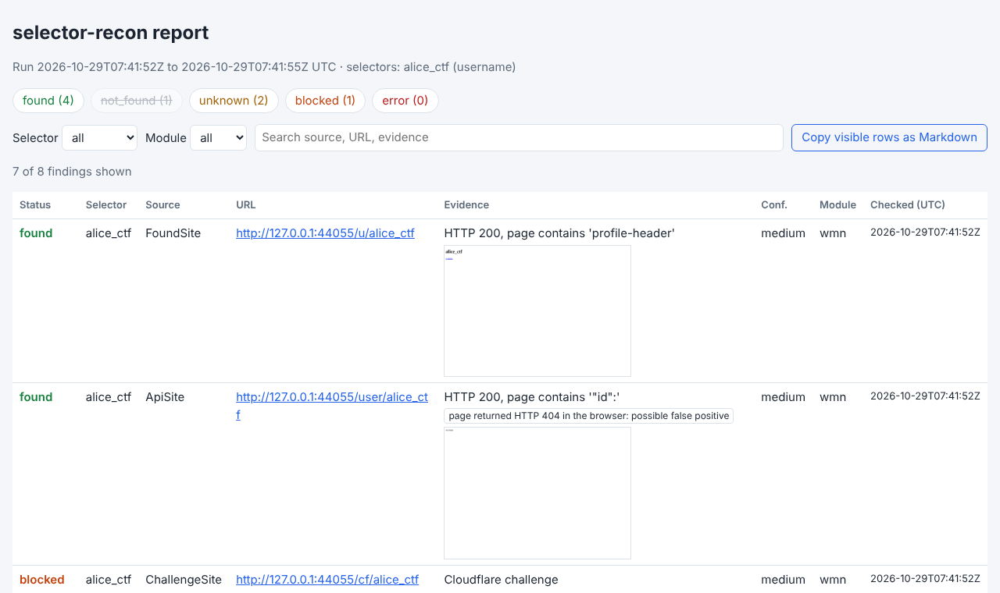

# selector-recon

Passive OSINT lookups for **email addresses, phone numbers, usernames, domains and IPs**.
Give it one or more selectors; it asks public sources what they know and writes the answers
as evidence you can paste straight into notes: source, URL, UTC timestamp, status and a short
piece of evidence. Built for OSINT CTF challenges, where the first step on every new selector
is the same.

**Status:** beta · **Version:** 0.1.0 · **Type:** Python command-line tool (not a browser tool like the others in this repository) · **Python:** 3.10+

> **Responsible use.** Do not run this tool on selectors of real private persons without a
> legitimate reason. It is meant for CTF personas, your own accounts and authorized work. Every
> module is passive towards the target (no messages, follows, sign-ups, logins or password
> resets), but looking someone up is still processing their personal data. See
> [Ethics and scope](#ethics-and-scope).



*`report.html` of a run against the local test fixtures (fictional sites on 127.0.0.1), with the `screenshots` adapter. Note the flagged possible false positive.*

## Contents

[Quick start](#quick-start) · [Install](#install) · [Usage](#usage) · [Output](#output) ·
[Modules](#modules) · [Browser adapters](#browser-adapters) · [How it works](#how-it-works) ·
[Ethics and scope](#ethics-and-scope) · [Limitations](#limitations) · [Tests](#tests) ·
[Project layout](#project-layout) · [Attribution](#third-party-code-data-and-attribution) · [Changelog](#changelog)

## Quick start

```bash
cd tools/selector-recon
python3 -m venv .venv
.venv/bin/pip install -r requirements.txt
.venv/bin/pip install --no-deps -e .
.venv/bin/selector-recon mrrobot user@example.com --out runs/first
```

Open `runs/first/report.html` in your browser, or paste `runs/first/findings.md` into your notes.
A finished example is in [`samples/`](samples/).

## Install

selector-recon lives in its own folder and installs into a virtual environment in that folder;
nothing is installed globally.

### Python package

| OS | Commands (run inside `tools/selector-recon`) |
|---|---|
| Linux / macOS | `python3 -m venv .venv` then `.venv/bin/pip install -r requirements.txt` then `.venv/bin/pip install --no-deps -e .` |
| Windows (PowerShell) | `py -m venv .venv` then `.venv\Scripts\pip install -r requirements.txt` then `.venv\Scripts\pip install --no-deps -e .` |

On Debian/Ubuntu you may first need `sudo apt install python3-venv`.

`requirements.txt` pins every direct dependency to the version this release was tested with,
including Sherlock, Maigret and Playwright. For a smaller install, choose extras instead:

```bash
.venv/bin/pip install -e .                    # core: WhatsMyName, email, phone, domain, IP modules
.venv/bin/pip install -e '.[sherlock,maigret]' # + Sherlock and Maigret
.venv/bin/pip install -e '.[browser]'          # + Playwright for the browser adapters
```

The opt-in `holehe` module needs holehe, which is GPL-3.0 and therefore kept separate:
`pip install -r requirements-holehe.txt`.

### Browser and driver (only for the browser adapters)

The browser adapters use [Playwright](https://playwright.dev/python/) with Chromium. Playwright
brings a matching browser build, so there is no separate driver to keep in sync. Everything else
works without a browser; browser modules are then skipped with a message.

| Platform | Install |
|---|---|
| Windows | `.venv\Scripts\pip install playwright==1.63.0` then `.venv\Scripts\playwright install chromium` |
| macOS | `.venv/bin/pip install playwright==1.63.0` then `.venv/bin/playwright install chromium` |
| Debian / Ubuntu | `.venv/bin/pip install playwright==1.63.0` then `.venv/bin/playwright install --with-deps chromium` (`--with-deps` installs system libraries via `sudo apt`) |
| Existing Chrome or Chromium | skip `playwright install` and pass `--browser-path /path/to/chrome` |

Docker (Playwright's official image already contains Chromium and its libraries; untested here):

```bash
docker run --rm -it -v "$PWD":/work -w /work mcr.microsoft.com/playwright/python:v1.63.0-noble \
  sh -c "pip install -r requirements.txt && pip install --no-deps -e . && selector-recon mrrobot --out runs/docker"
```

Browser data never touches your own Chrome profile: each run uses a fresh, in-memory browser
context that is thrown away at the end.

### API keys (all optional)

Copy [`.env.example`](.env.example) to `.env` (git-ignored) and fill in what you have, or export
the variables in your shell. Values already set in the environment win over `.env`. Only key
*names* are ever printed; keys never appear in output files or logs.

| Variable | Used by | Without it |
|---|---|---|
| `HIBP_API_KEY` | `hibp` | manual-check link to the HIBP website |
| `SHODAN_API_KEY` | `shodan`, `shodan_dns` | `shodan` uses the free InternetDB; `shodan_dns` is skipped |
| `CENSYS_API_TOKEN`, `CENSYS_ORG_ID` | `censys` (opt-in) | skipped |
| `GRAVATAR_API_KEY` | `gravatar` | works, with a lower rate limit |

## Usage

```bash
selector-recon mrrobot                                   # username
selector-recon user@example.com +4915123456789           # several selectors, types auto-detected
selector-recon alice.ctf --type username                 # force the type (alice.ctf would not be a domain anyway)
selector-recon 015123456789 --region DE                  # national number format
selector-recon -f selectors.txt --out runs/case7         # one selector per line, # comments allowed
selector-recon user@example.com --modules +holehe,+hibp_web
selector-recon mrrobot --modules wmn,screenshots         # exactly these modules
selector-recon mrrobot --pivot 1                         # also run the pivot hints, one level deep
selector-recon --offline user@example.com                # only modules that need no network
selector-recon --list-modules                            # what is available and why something is not
```

| Option | Meaning |
|---|---|
| `-t, --type` | force `email`, `phone`, `username`, `domain` or `ip` for all inputs |
| `-m, --modules` | `a,b` runs exactly these; `+a,-b` changes the defaults; `all` runs everything |
| `-o, --out` | output directory (default `runs/<UTC timestamp>`, git-ignored) |
| `--offline` | only modules without network access |
| `--timeout` / `--rate` / `--workers` | per-request timeout (10 s), requests per second **per host** (1), parallel requests across hosts (16) |
| `--pivot 0\|1` | follow pivot hints one level deep; never deeper |
| `--no-nsfw` | skip sites tagged NSFW (included by default) |
| `--obey-robots` | apply robots.txt to plain HTTP modules too (browser adapters always obey it) |
| `--browser-ua` | send one fixed desktop-browser User-Agent instead of the honest one (more hits, less honest) |
| `--dns-server IP` | use this resolver instead of the system one (repeatable) |
| `--no-browser`, `--browser-path`, `--max-screenshots` | browser adapter control |
| `--env-file` | file with API keys (default `./.env`) |
| `--wmn-data`, `--maigret-top`, `--cache-dir` | data file override, Maigret site count (500), cache location |
| `-v` / `-q` | debug logging / no progress output |

**Type detection:** an IP parses as an IP; `x@y.tld` is an email; `+`, digits and separators with at
least 7 digits is a phone number; a dotted name whose last label is a real TLD is a domain
(so `john.doe` stays a username, `john.dev` becomes a domain); everything else is a username.
Use `--type` when the guess is wrong.

## Output

Each run writes three files to `--out`:

| File | For | Content |
|---|---|---|
| `findings.md` | your notes | one table per selector (found, blocked and unclear results first; *not found* only counted), a **Manual checks** checklist, **Pivot hints**, skipped modules |
| `findings.json` | machines | everything: run metadata, config, every finding, module runs, manual checks, pivots |
| `report.html` | you, in a browser | one self-contained file (no CDN, no external requests): filter by status, selector, module and text; copy visible rows as Markdown; screenshots inline |
| `screenshots/` | evidence | PNGs from browser adapters, referenced from the report |

**Statuses**

| Status | Meaning |
|---|---|
| `found` | the source says the selector exists there, or returned data about it |
| `not_found` | the source says it does not exist |
| `unknown` | the answer was inconclusive, or the row is a manual lookup link |
| `blocked` | CAPTCHA, bot challenge, rate limit or WAF; goes to **Manual checks** (expected, not a tool failure) |
| `error` | network error, bad key, unparseable answer |

Every finding also has a **confidence** (`low` / `medium` / `high`). When several username modules
check the same site, agreement raises it to `high` (`confirmed by N modules`) and disagreement
lowers it to `low` with a `sources disagree: …` flag, so you know which hits to verify by hand.

**Pivot hints** are new selectors seen in results (the local part of an email, a username on a
Gravatar profile, IPs of a domain, subdomains from certificates, hostnames from Shodan). They are
listed, never followed, unless you pass `--pivot 1`.

Sample (`samples/findings.md`, offline run):

```markdown
## `+4915123456789` (phone)

| Status | Source | URL | Evidence | Confidence | Module | Checked (UTC) |
|---|---|---|---|---|---|---|
| found | phonenumbers |  | valid; mobile; +4915123456789; Germany; carrier T-Mobile (original allocation; ported numbers differ); tz Europe/Berlin | high | phone_info | 2026-10-29T07:44:54Z |

6 manual lookup link(s) under Manual checks.
```

A blocked result looks like this (illustrative row):

```markdown
| blocked | ChallengeSite | <https://challenge.example/alice_ctf> | Cloudflare challenge | medium | wmn | 2026-10-29T07:41:52Z |
```

## Modules

One file per source in [`src/selector_recon/modules/`](src/selector_recon/modules/). `opt-in`
modules run only when named in `--modules` (e.g. `--modules +censys`). The table is generated
from the modules' own metadata (`python scripts/module_table.py --write`).

<!-- module-table:start -->
| Module | Selectors | Default | Network | Key (env var) | Source | License | ToS / terms | Could notify the owner? |
|---|---|---|---|---|---|---|---|---|
| `censys` | ip | opt-in | yes | `CENSYS_API_TOKEN` (required) | [Censys](https://docs.censys.com/) | API | Censys ToS; host lookups may consume credits depending on plan. | no (data comes from Censys's own past scans) |
| `crtsh` | domain | yes | yes | - | [crt.sh](https://crt.sh/) | data from public CT logs | Free community service by Sectigo; slow and often overloaded, so one query per domain with a long timeout. | no |
| `dns` | domain, email, ip | yes | yes | - | [DNS](https://www.dnspython.org/) | dnspython ISC | Standard DNS queries via your resolver. | no (the domain's nameserver only sees a query from your resolver) |
| `email_info` | email | yes | no | - | [Email syntax](https://github.com/disposable-email-domains/disposable-email-domains) | own code; disposable list CC0 | No network access. | no |
| `gravatar` | email | yes | yes | `GRAVATAR_API_KEY` (optional) | [Gravatar](https://docs.gravatar.com/) | API | Public profile API; optional API key raises the rate limit. Gravatar ToS apply. | no |
| `hibp` | email | yes | yes | `HIBP_API_KEY` (optional) | [Have I Been Pwned](https://haveibeenpwned.com/API/v3) | API (attribution required) | Paid API key; rate limit per plan (selector-recon waits 6.5 s between calls). Attribute HIBP when citing. | no |
| `hibp_web` | email | opt-in | browser | - | [HIBP website](https://haveibeenpwned.com/) | website | Public search page; HIBP offers the API for automated use, so prefer the hibp module with a key. | no |
| `holehe` | email | opt-in | yes | - | [holehe](https://github.com/megadose/holehe) | GPL-3.0 (optional extra, not vendored) | Public lookup endpoints only; sign-up, login and password-reset checks are never run. | no (only reviewed passive checks run) |
| `ip_info` | ip | yes | no | - | IP address | own code | No network access. | no |
| `maigret` | username | yes | yes | - | [Maigret](https://github.com/soxoj/maigret) | MIT | Plain GET of public profile pages; each site's own ToS applies. Impersonation and bypass features disabled. | no |
| `phone_info` | phone | yes | no | - | [phonenumbers](https://github.com/daviddrysdale/python-phonenumbers) | Apache-2.0 | No network access. | no |
| `phone_links` | phone | yes | no | - | Phone lookup links | own code | Links only; you open them yourself. | no (links are not opened; do not message the number) |
| `proton` | email | yes | yes | - | [Proton key server](https://proton.me/support/pgp-key-management) | API | Public HKP key server lookup, the same request a mail client makes before encrypting. | no |
| `rdap` | domain, ip | yes | yes | - | [RDAP](https://about.rdap.org/) | registry data, terms per registry | Public RDAP servers; registries limit query rates. | no |
| `screenshots` | email, username | opt-in | browser | - | Screenshots | own code | Opens only pages other modules already found, one at a time; robots.txt respected. | no (a profile view without login; sites that list visitors are rare) |
| `sherlock` | username | yes | yes | - | [Sherlock](https://github.com/sherlock-project/sherlock) | MIT | Plain GET of public profile pages; each site's own ToS applies. | no |
| `shodan` | ip | yes | yes | `SHODAN_API_KEY` (optional) | [Shodan](https://www.shodan.io/) | API; InternetDB free for non-commercial use | Shodan ToS; InternetDB is free for non-commercial use. Host lookups use no query credits. | no (data comes from Shodan's own past scans) |
| `shodan_dns` | domain | opt-in | yes | `SHODAN_API_KEY` (required) | [Shodan DNS](https://developer.shodan.io/api) | API | Shodan ToS; each lookup uses one query credit. | no |
| `wayback` | domain | yes | yes | - | [Wayback Machine](https://archive.org/developers/wayback-cdx-server.html) | archive.org terms | Public CDX API; two small queries per domain. | no |
| `wmn` | username | yes | yes | - | [WhatsMyName](https://github.com/WebBreacher/WhatsMyName) | data CC BY-SA 4.0 | Plain GET/POST of public profile pages; each site's own ToS applies. Rate-limited per host. | no (sites that list profile visitors are rare; none are logged in) |
<!-- module-table:end -->

**Excluded on purpose:** every check that uses a sign-up, login or password-reset flow (that is
~120 of holehe's checks, and why holehe is opt-in and limited to four reviewed checks), paste
lookups, and any source that shows or sells passwords, hashes or dump contents.

## Browser adapters

Some sources only work in a real browser. Browser adapters are modules with `needs_browser = True`
that run after all other modules, one page at a time, in one headless Chromium per run.

Rules enforced by [`browser.py`](src/selector_recon/browser.py) for every adapter:

- open a public page, type the selector into its search field, read the rendered result, save a
  screenshot as evidence;
- a fresh, non-persistent browser context, never your normal profile, cookies or logins;
- robots.txt is checked before every page;
- no logins, no account creation, no CAPTCHA solving or bypassing, no stealth or "undetected"
  driver plugins, no fingerprint spoofing, no rotating proxies, no paywall bypass;
- a CAPTCHA, block page or bot challenge gives status `blocked` and a manual-check entry with the
  screenshot; you open those yourself.

| Adapter | What it does | ToS note |
|---|---|---|
| `hibp_web` (opt-in) | searches the address on the HIBP website without an API key, reads the answer, takes a screenshot; skipped when `HIBP_API_KEY` is set | HIBP offers the paid API for automated lookups and protects the site with Cloudflare Turnstile. **Check HIBP's terms of use before enabling it**; expect `blocked` and use the manual link. |
| `screenshots` (opt-in) | saves a screenshot of each found profile page (cap `--max-screenshots`) and attaches it to the existing finding; flags pages that show a 404 or a bot challenge in the browser as possible false positives | opens only pages other modules already found, one at a time, without login; each site's own terms apply |

Adding an adapter: subclass `BrowserModule`, call `self.open_page(...)` or use `ctx.browser`, and
return findings. If a source mixes breach metadata with leaked content, it is not built.

## How it works

```
selectors ─▶ detect type ─▶ for each selector: modules for that type (network, then browser)
                                  │ module.run(selector, ctx) -> list[Finding]
                                  ▼
             cross-check sites across username modules ─▶ findings.json · findings.md · report.html
```

- **Modules** declare `name`, `selector_types`, `needs_network`, `needs_browser`, `needs_key` and
  implement `run(selector, ctx) -> list[Finding]`. `ctx` carries the shared HTTP client, DNS
  client, browser session and options, so modules have no global state and are easy to test.
- **Failure isolation:** a module that raises becomes one `error` finding; the run continues.
  Ctrl+C writes the partial results.
- **HTTP:** one client per run with an honest User-Agent
  (`selector-recon/0.1.0 (+https://github.com/landmark2436/osint_tools_claude)`), an in-memory
  response cache, a per-host rate limit and stricter per-API intervals (HIBP: 6.5 s).
- **DNS:** system resolver by default. If the resolver claims that `iana.org` does not exist,
  NXDOMAIN answers are not trusted and reported as errors instead of false "does not exist".
- **WhatsMyName:** `wmn-data.json` is downloaded from a pinned upstream commit, verified by
  SHA-256 and cached in `~/.cache/selector-recon`. A site counts as *found* only when both
  `e_code` and `e_string` match, *not found* when `m_code` and `m_string` match; redirects are
  not followed because many sites signal "missing" with one.
- **Sherlock / Maigret** run as libraries with their bundled site lists. selector-recon replaces
  their fake or random browser User-Agents with its own, keeps Maigret's Cloudflare bypass off and
  skips Maigret sites that need TLS fingerprint impersonation (reported as skipped).

### Adding a module

Create `src/selector_recon/modules/<name>.py` with a `Module` subclass; it is picked up
automatically. Add a fixture-based test in `tests/` and regenerate the module table.

## Ethics and scope

- **Passive towards the target.** Nothing is sent to the person behind a selector: no messages,
  follows, friend requests, sign-ups, logins or password resets. Phone lookups are links you
  open yourself; opening them sends nothing to the number.
- **No real private persons without a legitimate reason.** CTF selectors usually belong to
  fictional personas. The test suite and samples use only reserved or fictional selectors
  (RFC 2606 domains, RFC 5737 IPs, the `phonenumbers` example number, made-up usernames).
- **Leak data:** breach *metadata* only (which breach, date, data classes). selector-recon never
  queries pastes, never uses sources that show or sell passwords, hashes or dump contents, and
  never downloads dumps. In Germany, handling leaked data can be a criminal offence
  (Datenhehlerei, § 202d StGB).
- **Terms and robots.txt:** browser adapters always respect robots.txt; plain HTTP modules do with
  `--obey-robots`. Each source's terms apply (see the module table). The default User-Agent says
  what the tool is.
- **No secrets in the repository:** keys come from the environment or a git-ignored `.env`;
  `.env.example` has no values.
- Results are **leads, not proof**. Verify anything that matters by hand.

## Limitations

- Account-existence checks have false positives and negatives; sites change faster than the
  upstream site lists. Use the cross-check flags and `screenshots` to verify.
- The honest User-Agent costs hits: many sites answer bots differently. `--browser-ua` helps
  but is less honest; use it knowingly.
- Phone carrier data is the original allocation; ported numbers show the old carrier.
- RDAP coverage depends on the registry; some ccTLDs have no public RDAP (a WHOIS link is added).
- crt.sh is often overloaded; on errors you get a manual link.
- The Censys and Shodan host parsers follow the documented formats and are tested against
  fixtures, not against live responses (see [Live smoke test](#live-smoke-test)).
- `hibp_web` follows the HIBP website as it was known when written; if the page layout changes,
  it reports `unknown` with a screenshot.

## Tests

```bash
.venv/bin/pip install pytest==8.4.2   # included in requirements.txt
.venv/bin/python -m pytest
```

The tests never touch the internet. HTTP modules talk to a local fixture server
(`tests/conftest.py`) that serves canned responses from [`tests/fixtures/`](tests/fixtures/);
WhatsMyName, Sherlock and Maigret run their real code paths against it; DNS uses a fake resolver;
browser adapters run in headless Chromium against local pages (skipped if no browser is
installed); holehe's hardcoded URLs are answered by an httpx mock transport. The fixtures are
minimal responses written from the documented formats, using fictional personas only.

### Offline sample

```bash
selector-recon --offline --out samples user@example.com +4915123456789 mrrobot example.com 192.0.2.1
```

### Live smoke test

One real run against the live internet, to see that the modules behave on real sites. Run it on
your own machine with selectors you are allowed to look up (your own username, a CTF persona):

```bash
selector-recon <your-username> <your-email> --modules +screenshots --out runs/smoke
```

Then check `runs/smoke/findings.md`: obvious accounts of yours should be `found`, some sites
`blocked` or `unknown`, and no module should be `failed` in the module list.

## Project layout

```text
tools/selector-recon/
├── README.md               this file
├── pyproject.toml          package metadata, extras, console script
├── requirements.txt        pinned versions (core, Sherlock, Maigret, Playwright, pytest)
├── requirements-holehe.txt optional GPL-3.0 holehe, pinned to a commit
├── .env.example            API key names, no values
├── docs/report.png         report screenshot
├── samples/                offline sample run (findings.md/.json, report.html)
├── scripts/                update_tlds.py, module_table.py
├── src/selector_recon/
│   ├── cli.py              command line
│   ├── runner.py           module selection, failure isolation, cross-checks, pivots
│   ├── models.py           Finding, Selector, Pivot, Status, Confidence
│   ├── detect.py           selector type detection and normalization
│   ├── http.py             HTTP client: User-Agent, cache, rate limits, robots.txt, block detection
│   ├── dnsutil.py          cached DNS client with untrusted-resolver detection
│   ├── browser.py          Playwright session for browser adapters
│   ├── data/               TLD list, disposable and free-mail domain lists
│   ├── modules/            one file per source
│   └── output/             findings.json, findings.md, report.html writers
└── tests/                  pytest suite and fixtures
```

## Third-party code, data and attribution

| Component | Version | License | Use |
|---|---|---|---|
| [WhatsMyName](https://github.com/WebBreacher/WhatsMyName) data, © Micah Hoffman and contributors | commit `35576e9` | CC BY-SA 4.0 | downloaded at runtime, not vendored |
| [Sherlock](https://github.com/sherlock-project/sherlock) | 0.16.2 | MIT | library |
| [Maigret](https://github.com/soxoj/maigret) | 0.6.6 | MIT | library |
| [holehe](https://github.com/megadose/holehe) | commit `14da70f` | GPL-3.0 | optional, opt-in, not vendored |
| [phonenumbers](https://github.com/daviddrysdale/python-phonenumbers) | 9.0.42 | Apache-2.0 | library |
| [dnspython](https://www.dnspython.org/) | 2.8.0 | ISC | library |
| [HTTPX](https://www.python-httpx.org/) | 0.28.1 | BSD-3-Clause | library |
| [Playwright for Python](https://playwright.dev/python/) | 1.63.0 | Apache-2.0 | optional, browser adapters |
| [disposable-email-domains](https://github.com/disposable-email-domains/disposable-email-domains) | commit `fa96007` | CC0 1.0 | vendored list |
| [Public Suffix List](https://publicsuffix.org/) | commit `9dfbe81` | MPL-2.0 | TLD list derived from it |
| Have I Been Pwned, Gravatar, Proton, RDAP, crt.sh, Internet Archive, Shodan, Censys | – | their terms | queried at runtime; cite HIBP when you use its data |

selector-recon's own code is [MIT](../../LICENSE).

## Changelog

### v0.1.0 – 2026-10-29

- Initial release: 20 modules for usernames, emails, phone numbers, domains and IPs; JSON,
  Markdown and self-contained HTML output; browser adapter framework with `hibp_web` and
  `screenshots`.
